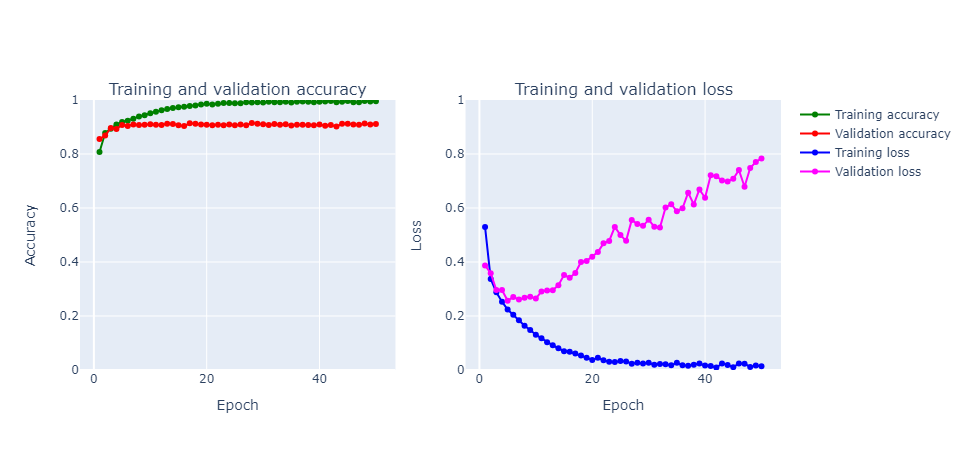
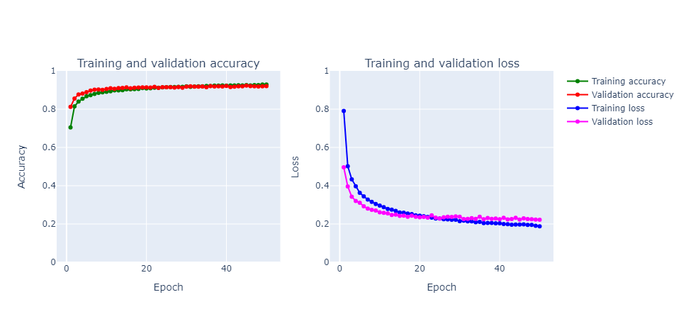

# Fashion-MNIST Clothing Classifier (CNN)

College diploma project: classifying online-store product images with a convolutional neural network built in TensorFlow/Keras.

Original thesis title (Armenian): *Առցանց խանութի ապրանքների գրադարանի կլասիֆիկացում և վիզուալիզացում* (Classification and visualization of an online store's product catalog).

## Results

| Model | Test accuracy | Test loss | Notes |
|---|---|---|---|
| Baseline CNN | 91.5% | 0.71 | Overfits: validation loss grows after a few epochs |
| CNN + Dropout | **92.8%** | **0.20** | Train and validation curves stay close |

10,000 test images: 9,283 classified correctly, 717 incorrectly.

| Class | Precision | Recall | F1 |
|---|---|---|---|
| T-shirt/top | 0.90 | 0.88 | 0.89 |
| Trouser | 0.99 | 0.99 | 0.99 |
| Pullover | 0.87 | 0.89 | 0.88 |
| Dress | 0.92 | 0.95 | 0.94 |
| Coat | 0.90 | 0.88 | 0.89 |
| Sandal | 1.00 | 0.97 | 0.98 |
| Shirt | 0.80 | 0.80 | 0.80 |
| Sneaker | 0.96 | 0.97 | 0.96 |
| Bag | 0.98 | 0.99 | 0.99 |
| Ankle Boot | 0.97 | 0.97 | 0.97 |

**Shirt** is the hardest class. It is most often confused with T-shirt/top, Pullover and Coat, which look alike at 28×28.

### Training curves

Baseline: validation loss rises while training accuracy approaches 100%, a clear sign of overfitting.



With Dropout (0.25 / 0.25 / 0.4 / 0.3), the gap between training and validation closes:



## Model

```
Conv2D(32, 3×3, ReLU, he_normal) → MaxPool(2×2) → Dropout(0.25)
Conv2D(64, 3×3, ReLU)            → MaxPool(2×2) → Dropout(0.25)
Conv2D(128, 3×3, ReLU)           → Dropout(0.4)
Flatten → Dense(128, ReLU) → Dropout(0.3) → Dense(10, Softmax)
```

- 241,546 parameters, Adam optimizer, categorical cross-entropy
- 50 epochs, batch size 128
- Data split: 48,000 train / 12,000 validation / 10,000 test

## Dataset

[Fashion-MNIST](https://github.com/zalandoresearch/fashion-mnist) from Zalando: 70,000 grayscale 28×28 images in 10 balanced classes. It is not included in this repo. Download the CSV files from [Kaggle](https://www.kaggle.com/datasets/zalando-research/fashionmnist) and put them in `input/`:

```
input/fashion-mnist_train.csv
input/fashion-mnist_test.csv
```

## How to run

```bash
python -m venv .venv
.venv\Scripts\activate          # Windows  (Linux/macOS: source .venv/bin/activate)
pip install -r requirements.txt
jupyter notebook cnn_fashion-mnist.ipynb
```

Running the notebook trains both models and saves the final one to `model/fashion_cnn.keras`.

### Classify your own photo

```bash
python predict.py my_sneaker.jpg
```

It prints the three most likely classes with their probabilities.

Fashion-MNIST items are light on a black background, so `predict.py` turns the photo into a 28×28 grayscale image and inverts it when the background is light. Photos of a single item on a plain background work best.

## Project structure

```
cnn_fashion-mnist.ipynb   EDA, training, evaluation, visualization (comments in Armenian)
predict.py                Prediction on a user's image
docs/                     Training curves and model diagram
requirements.txt
```

## Tech

Python · TensorFlow / Keras · NumPy · pandas · scikit-learn · Matplotlib · Seaborn · Plotly · Pillow

## Acknowledgements

This was a learning project, and the notebook is built on public Kaggle work. The main base is
[CNN with Tensorflow|Keras for Fashion MNIST](https://www.kaggle.com/code/gpreda/cnn-with-tensorflow-keras-for-fashion-mnist)
by Gabriel Preda: the overall structure, the model architecture and the plotting helpers come from it.
Ideas were also taken from these Kaggle notebooks:

- [Deep Learning From Scratch](https://www.kaggle.com/dansbecker/deep-learning-from-scratch) and [Dropout and Strides for Larger Models](https://www.kaggle.com/dansbecker/dropout-and-strides-for-larger-models) by DanB
- [CNN with Keras](https://www.kaggle.com/bugraokcu/cnn-with-keras) by BGO
- [EagerFMNIST](https://www.kaggle.com/aakashnain/eagerfmnist) by Aakash Nain

My own work in this project:

- Training and evaluating the models locally, then analyzing the results
- Documentation and explanations in Armenian for the college diploma (thesis, 104 pages)
- Classifying the user's own photos (`predict.py`), including preprocessing a real photo to match the dataset format

## References

- Xiao, Rasul, Vollgraf. *Fashion-MNIST: a Novel Image Dataset for Benchmarking Machine Learning Algorithms* (2017)
- Srivastava et al. *Dropout: A Simple Way to Prevent Neural Networks from Overfitting* (JMLR, 2014)
